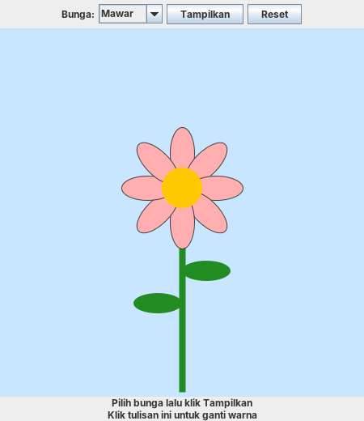
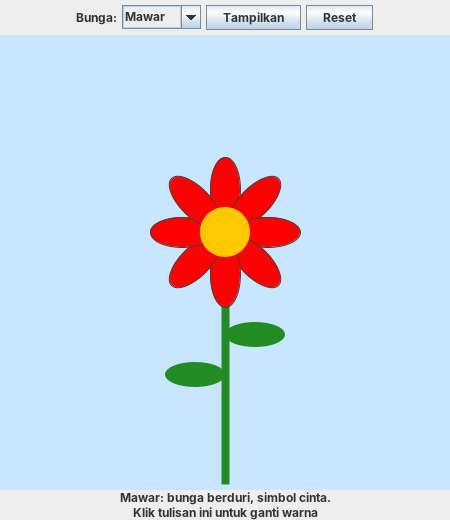
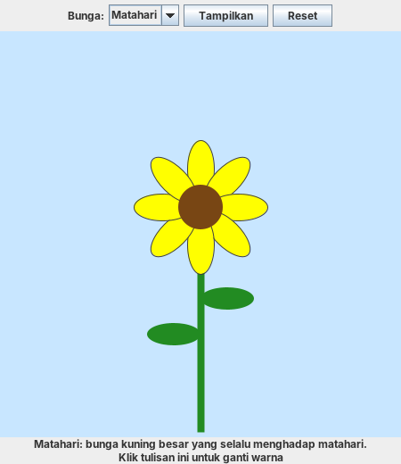
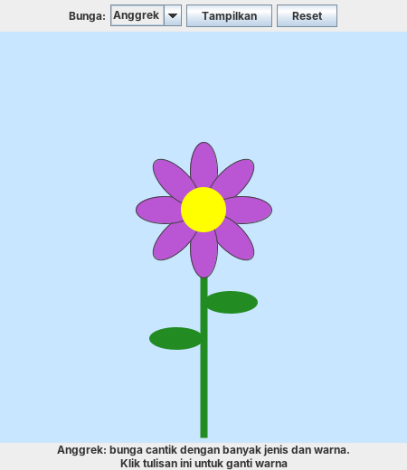

# 3A - Self Exercise/Exploration of Graphical User Interface in Java

Repository ini berisi tugas eksplorasi GUI Java (Swing) pada mata kuliah Pemrograman Berorientasi Objek.

## Deskripsi Program

`BungaGUI.java` adalah program bertema bunga. Pengguna memilih jenis bunga (Mawar, Melati, Matahari, Anggrek) dari dropdown, lalu klik tombol **Tampilkan** untuk mengubah warna gambar bunga dan menampilkan deskripsinya.

## Komponen yang Dieksplorasi

| Syarat Tugas | Yang Digunakan |
|---|---|
| Top Level Container | `JFrame` |
| Intermediate Container | `JPanel` (termasuk `GambarBunga`, panel khusus untuk menggambar bunga) |
| Atomic Component | `JLabel`, `JComboBox`, `JButton` |
| Layout Classes (minimal 2) | `BorderLayout`, `FlowLayout`, `GridLayout` |
| Event Listener | `ActionListener` (Interface) dan `MouseAdapter` (Adapter Class), method di-override |

## Cara Menjalankan

Pastikan JDK sudah terpasang, lalu jalankan di terminal pada folder repository:

```bash
javac BungaGUI.java
java BungaGUI
```

## Hasil Tampilan

| Tampilan awal | Mawar |
|---|---|
|  |  |

| Matahari | Anggrek |
|---|---|
|  |  |

## Cara Menggunakan

1. Pilih jenis bunga pada dropdown.
2. Klik **Tampilkan** untuk mengubah warna bunga dan menampilkan deskripsinya.
3. Klik **Reset** untuk kembali ke tampilan awal.
4. Klik tulisan di bagian bawah untuk mengubah warnanya menjadi magenta.
